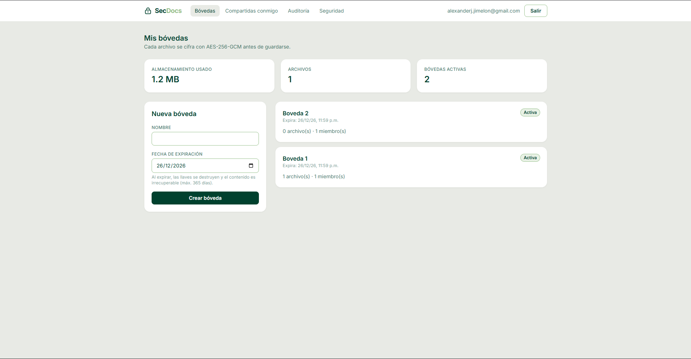

# SecDocs · Frontend

Interfaz web de **SecDocs**, una bóveda digital para guardar y compartir documentos confidenciales con cifrado en reposo y acceso por doble canal.

<p align="center">
  
</p>




## Qué es SecDocs

SecDocs permite que una persona cree **bóvedas** con fecha de expiración, suba documentos a ellas e invite a otras personas a descargarlos de forma controlada. Este repositorio es la interfaz; el cifrado, el almacenamiento y las reglas de acceso viven en el [backend](https://github.com/JILAJ06/SecDocs-Backend) y en la [base de datos](https://github.com/JILAJ06/SecDocs-DB).

Lo que el sistema hace y la interfaz refleja:

- **Cifrado AES-256-GCM en reposo.** Cada archivo tiene su propia llave, y esa llave está protegida por la llave maestra (KEK) de su bóveda. La interfaz solo muestra metadatos (algoritmo y estado de la KEK); el material de las llaves nunca sale del servidor.
- **Un enlace por receptor.** Cada persona invitada recibe su propio enlace de invitación, que se muestra al dueño **una sola vez**, vence junto con la bóveda y tiene un límite de descargas (de 1 a 10). Cada descarga exige además un **ticket de un solo uso** que vence a los 60 segundos.
- **Contraseña por un canal distinto.** El enlace (Canal 1) lo comparte el dueño; la clave de acceso le llega al invitado por correo (Canal 2).
- **Bloqueo tras 5 intentos.** Después de 5 claves incorrectas la invitación queda en bloqueo temporal; la interfaz muestra los intentos usados y el tiempo de espera.
- **Límite de peticiones.** El backend limita los intentos de inicio de sesión, registro y envío de clave (respuesta `429`); la interfaz muestra cuánto hay que esperar.
- **Bitácora de auditoría.** Inicios de sesión, subidas, invitaciones, desbloqueos, descargas y destrucciones quedan registrados con fecha e IP. La bitácora no guarda tokens ni claves.
- **Crypto-shredding.** Eliminar un archivo destruye su llave; eliminar una bóveda destruye su KEK y las llaves de todos sus archivos, revoca a sus miembros y borra los binarios cifrados. El contenido queda irrecuperable.

## Vistas de la interfaz

| Ruta | Vista | Qué permite |
|---|---|---|
| `/login`, `/register` | Iniciar sesión / Crear cuenta | Acceso con correo y contraseña. Tras entrar regresa a la página que se pidió (solo rutas internas). |
| `/vaults` | Mis bóvedas | Lista de bóvedas con su estado y expiración; crear una bóveda nueva. `/` redirige aquí. |
| `/vaults/[vaultId]` | Detalle de bóveda | Subir archivos (máx. 15 MB, formatos permitidos), ver las llaves, invitar miembros por correo, revocar accesos, bloquear o reactivar la bóveda y destruir archivos o la bóveda completa. |
| `/invitacion/[token]` | Invitación | Flujo del invitado: iniciar sesión con el correo invitado, verificar identidad, recibir la clave por correo, ingresarla y descargar con ticket. |
| `/shared` | Compartidas conmigo | Bóvedas a las que me invitaron, con descargas restantes. |
| `/audit` | Auditoría | Totales y gráficas por día (descargas, intentos fallidos, visitantes únicos) y bitácora paginada con filtros. |
| `/security` | Seguridad | Sesiones activas con IP y expiración, cerrar una sesión o todas a la vez (*kill-switch*). |

Las páginas privadas comparten una barra con cuatro pestañas: Bóvedas, Compartidas conmigo, Auditoría y Seguridad.

Paleta: verde bosque `#00412E`, salvia `#96BF8A`, niebla `#E8EAE5` y blanco. Tipografías Inter y JetBrains Mono.

## Stack tecnológico

| Herramienta | Versión (`package.json`) | Uso |
|---|---|---|
| Next.js | ^14.2.30 | App Router, *rewrites* hacia la API, cabeceras de seguridad, salida `standalone` |
| React | ^18.3.1 | Interfaz |
| Tailwind CSS | ^3.4.17 | Estilos (con PostCSS ^8.4.49 y Autoprefixer ^10.4.20) |
| `fetch` nativo | — | Cliente HTTP centralizado en `lib/api.js` (no usa Axios) |
| `next/font` | — | Inter y JetBrains Mono servidas desde el propio dominio |

## Requisitos previos

- Node.js 18.17 o superior (lo pide Next.js 14) y npm. La imagen de Docker usa Node 22.
- Conexión a internet al compilar: `next/font` descarga las tipografías en ese momento.
- Una instancia de [SecDocs-Backend](https://github.com/JILAJ06/SecDocs-Backend) en ejecución. Sin backend la interfaz carga, pero no puede iniciar sesión ni mostrar datos.
- Docker, solo si quieres ejecutarlo en contenedor.

## Ejecución en local

```bash
# 1. Variables de entorno
cp .env.example .env.local      # en PowerShell: Copy-Item .env.example .env.local

# 2. Dependencias
npm install

# 3. Desarrollo (http://localhost:3000)
npm run dev
```

Versión de producción:

```bash
npm run build
npm run start    # http://localhost:3000
```

Abre la aplicación en `http://localhost:3000`, no en `http://127.0.0.1:3000` (ver [Conexión con el backend](#conexión-con-el-backend)).

## Ejecución con Docker

El `Dockerfile` compila en modo `standalone` y ejecuta la app con el usuario `node` en el puerto 3000. Como las *rewrites* se fijan al compilar, la URL del backend se pasa como argumento de compilación (por defecto `http://api:4000`, pensado para un servicio llamado `api` en la misma red de Docker).

```bash
docker build --build-arg API_PROXY_TARGET=http://api:4000 -t secdocs-web .
docker run --rm -p 3000:3000 secdocs-web
```

Este repositorio no incluye `docker-compose.yml`.

## Variables de entorno

Se definen en `.env.local` (a partir de `.env.example`). Ese archivo no se sube al repositorio.

| Variable | Descripción | Ejemplo |
|---|---|---|
| `API_PROXY_TARGET` | URL del backend al que se reenvía `/api/v1/*`. Se fija al compilar: si la cambias, reinicia `npm run dev` o vuelve a ejecutar `npm run build`. Si no se define, se usa `http://localhost:4000`. | `http://localhost:4000` |

## Conexión con el backend

La web y la API se sirven bajo el **mismo origen**. Next.js reenvía cada petición a `/api/v1/*` hacia `API_PROXY_TARGET` (ver `next.config.mjs`). Así:

- La cookie de sesión `secdocs_session` es `HttpOnly` y `SameSite=Strict`, y viaja sola con cada petición.
- No hace falta configurar CORS.
- Usa el mismo nombre de host para la web y la API (`localhost` en ambos). Si mezclas `localhost` y `127.0.0.1`, el navegador no envía la cookie.

Todas las llamadas a la API pasan por `lib/api.js`. Ese archivo agrega las credenciales y convierte los errores en mensajes; si una ruta protegida responde `401`, limpia la sesión y manda a iniciar sesión.

Repositorios del proyecto:

- **SecDocs-Frontend**: este repositorio.
- [SecDocs-Backend](https://github.com/JILAJ06/SecDocs-Backend): API REST en Node.js y Express.
- [SecDocs-DB](https://github.com/JILAJ06/SecDocs-DB): esquema, migraciones y políticas de auditoría en PostgreSQL.

## Estructura de carpetas

```text
app/
  layout.jsx               layout raíz: tipografías y proveedor de sesión
  page.jsx                 redirige a /vaults
  login/, register/        acceso
  vaults/                  lista de bóvedas y detalle (vaults/[vaultId])
  invitacion/[token]/      flujo del invitado
  shared/                  bóvedas compartidas conmigo
  audit/                   auditoría
  security/                sesiones y kill-switch
  globals.css              estilos base y clases de Tailwind
components/
  AuthProvider.jsx         estado de sesión en memoria (usuario de /auth/me)
  AuthForm.jsx             formulario de inicio de sesión y registro
  Shell.jsx                marco de las páginas privadas y navegación
  ui.jsx                   componentes compartidos
lib/
  api.js                   cliente HTTP centralizado
  constants.js             estados, eventos de auditoría y límites
  format.js                formato de fechas y tamaños, redirecciones seguras
  hooks.js                 cuenta regresiva
public/                    archivos estáticos
ai/                        documentación interna del flujo de trabajo
next.config.mjs            rewrites, CSP y cabeceras de seguridad
tailwind.config.js         paleta y tipografías
Dockerfile                 imagen de producción
```

## Seguridad

Lo que hace la interfaz:

- **Nada sensible en el navegador.** No guarda tokens, contraseñas ni datos de sesión en `localStorage` o `sessionStorage`; la sesión es la cookie `HttpOnly`.
- **Ticket solo en memoria.** El ticket de descarga vive solo en la memoria de React y se borra al usarse o al vencer.
- **Cabeceras de seguridad en todas las páginas:**
  - `Content-Security-Policy` estricta, solo `'self'`: no carga recursos externos.
  - `X-Frame-Options: DENY`, `X-Content-Type-Options: nosniff` y `Referrer-Policy: no-referrer`.
  - `Permissions-Policy` sin cámara, micrófono ni ubicación.
  - `X-Robots-Tag` para que los buscadores no indexen el sitio.
- **La página de invitación no se guarda en caché** (`Cache-Control: no-store`), porque lleva el token en la URL.
- **Redirecciones solo internas.** Después de iniciar sesión solo se aceptan rutas del propio sitio, para evitar *open redirect*.
- **Subida de archivos.** La interfaz filtra por extensión y tamaño; la validación real se hace en el servidor por el contenido del archivo (*magic bytes*).

Qué **no** subir al repositorio:

- `.env`, `.env.local` ni otros `.env.*`. El `.gitignore` ya los excluye, salvo `.env.example`.
- URLs de producción con credenciales, tokens de invitación, claves de bóveda o tickets.
- Capturas, registros o datos de prueba con correos o documentos reales.
- `node_modules/` y `.next/`, que ya están en `.gitignore`.

## Autores

- Alexander Jiménez
- Sayd Quevedo

Proyecto de la materia **Seguridad Informática**, Universidad Politécnica de Chiapas.

## Licencia

Distribuido bajo la licencia MIT. Consulta [LICENSE.txt](LICENSE.txt).
