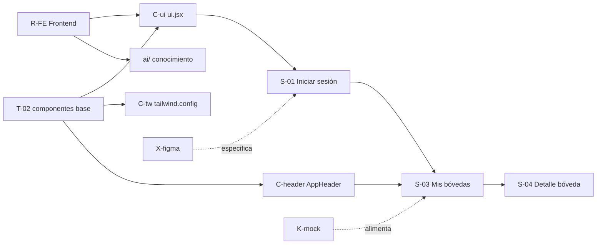

# Grafo de conocimiento · SecDocs-Frontend

**Última actualización:** 2026-11-19 · Claude Code (nodos de código al terminar T-03)
Reglas en `ai/conocimiento/08-grafo-de-conocimiento.md`. Estados: `planeado` · `en curso` · `hecho` · `obsoleto`.

## Vista general

## Repositorios
| ID | Nombre | Ruta | Estado | Relaciones |
|---|---|---|---|---|
| R-FE | SecDocs-Frontend | `/` | en curso | → contiene D-*, C-*, S-* |
| R-BE | SecDocs-Backend | (otro repo) | hecho | v1; no se toca |
| R-DB | SecDocs-DB | (otro repo) | hecho | esquema; no se toca |

## Documentos
| ID | Ruta | Estado | Relaciones |
|---|---|---|---|
| D-01 | `ai/conocimiento/01-proyecto.md` | hecho | → describe R-FE |
| D-02 | `ai/conocimiento/02-flujo-de-trabajo.md` | hecho | → define D-SIG, D-REP, D-GRF |
| D-03 | `ai/conocimiento/03-reglas-del-repo.md` | hecho | → reglas de commits, Tailwind y seguridad |
| D-04 | `ai/conocimiento/04-vistas-existentes.md` | hecho | → documenta V1-*, K-mock |
| D-05 | `ai/conocimiento/05-figma.md` | hecho | → mapea S-* a X-figma |
| D-06 | `ai/conocimiento/06-ramas-y-pull-requests.md` | hecho | → ramas y PR |
| D-07 | `ai/conocimiento/07-decisiones.md` | hecho | → manda sobre los demás |
| D-08 | `ai/conocimiento/08-grafo-de-conocimiento.md` | hecho | → define D-GRF |
| D-SIG | `ai/siguiente.md` | en curso | → apunta a D-PLAN |
| D-PLAN | `ai/plan-vistas.md` | en curso | → plan completo T-03 ajuste a T-19; reemplaza el ciclo tarea por tarea |
| D-REP | `ai/reporte.md` | en curso | → reporte de Code |
| D-GRF | `ai/grafo.md` | en curso | este archivo |

## Tareas
| ID | Rama | Estado | Relaciones |
|---|---|---|---|
| T-00 | `00-reconocimiento` | hecho | PR #1 → D-04 |
| T-01 | `00-dependencias` | hecho | PR #2 → X-next, X-react |
| T-02 | `00-componentes-base` | hecho | PR #3 → C-tw, C-ui, C-header |
| T-03 | `01-autenticacion` | en curso | → S-01, S-02, C-session, C-services, K-mock |
| T-04 | `02-datos-y-servicios` | planeado | → C-mock, C-services (ver D-PLAN) |
| T-05 | `03-mis-boveda-lista` | planeado | → S-03 |
| T-06 | `04-modal-nueva-boveda` | planeado | → S-03 (modal 03b) |
| T-07…T-10 | `05-detalle-encabezado`, `06-detalle-archivos`, `07-detalle-miembros`, `08-detalle-invitar-llaves` | planeado | → S-04 |
| T-11…T-13 | `09-invitacion-login`, `10-invitacion-verificada`, `11-invitacion-denegada` | planeado | → S-05, S-06, S-07 |
| T-14, T-15 | `12-boveda-compartida-contrasena`, `13-boveda-compartida-archivos` | planeado | → S-09, S-10, S-13 |
| T-16 | `14-auditoria` | planeado | → S-11 |
| T-17 | `15-seguridad` | planeado | → S-12 |
| T-18, T-19 | `16-pulido-y-accesibilidad`, `17-cierre` | planeado | → todo el frontend |

## Pantallas v2 (Figma, sección "04 · Pantallas")
| ID | Pantalla | Ruta | Figma | Estado | Relaciones |
|---|---|---|---|---|---|
| S-01 | Iniciar sesión | `/login` | 6:23 | en curso | → reemplaza V1-login; → navega a S-03 |
| S-02 | Crear cuenta | `/register` | 6:52 | en curso | → reemplaza V1-register |
| S-03 | Mis bóvedas (+ modal 03b 29:644) | `/vaults` | 29:474 | planeado | → usa C-header; → navega a S-04 |
| S-04 | Detalle de bóveda | `/vaults/[id]` | 29:835 | planeado | → usa C-header |
| S-05/06/07 | Invitación | `/invitacion/[token]` | 30:877 / 30:911 / 30:964 | planeado | — |
| S-08 | Correo (no es página) | — | 30:1004 | planeado | texto de ejemplo |
| S-09/10 | Bóveda compartida | `/shared/[id]` | 30:1036 / 30:1081 | planeado | — |
| S-11 | Auditoría | `/audit` | 31:1055 | planeado | → reemplaza V1-audit |
| S-12 | Seguridad | `/security` | 31:1187 | planeado | → usa C-header |
| S-13 | Compartidas conmigo (lista) | `/shared` | sin diseño | planeado | marcador "Próximamente" |

## Vistas v1 (referencia; se retiran cuando Chat lo indique)
| ID | Ruta | Archivo | Estado | Relaciones |
|---|---|---|---|---|
| V1-login | `/login` | `app/login` + `components/AuthForm.jsx` | hecho | → será reemplazada por S-01 |
| V1-register | `/register` | `app/register` | hecho | → será reemplazada por S-02 |
| V1-dashboard | `/dashboard` | `app/dashboard/page.jsx` | hecho | → usa C-shell, C-ui, C-api |
| V1-audit | `/audit` | `app/audit/page.jsx` | hecho | → será reemplazada por S-11 |
| V1-share | `/s/[token]` | `app/s/[token]/page.jsx` | hecho | → usa C-ui, C-api |

## Código
| ID | Ruta | Estado | Relaciones |
|---|---|---|---|
| C-ui | `components/ui.jsx` | hecho | `Brand` (grande/chico, `currentColor`), `Button` (primary/secondary/danger), `StatusBadge` (12 estados v1+v2), `Field`, `Select`, `CopyField` (→ usa `Button`), `Alert` (error/warn/ok + info v1); → usa C-tw; lo usan C-header, C-shell, C-authform, V1-dashboard, V1-audit, V1-share |
| C-header | `components/AppHeader.jsx` | hecho | encabezado v2 (pestañas Bóvedas, Compartidas conmigo, Auditoría, Seguridad; props `active`, `email`, `onLogout`) → usa C-ui (`Brand`, `Button`); → navega a S-03, S-13, S-11, S-12; sin estado ni sesión |
| C-shell | `components/Shell.jsx` | hecho | v1; → usa C-ui |
| C-authform | `components/AuthForm.jsx` | hecho | v2: pantallas S-01 y S-02 (`mode="login" \| "register"`); → usa C-session, C-services (vía C-session), C-ui (`Brand`, `Field`, `Button`, `Alert`); ya no usa C-api |
| C-session | `components/SessionProvider.jsx` | hecho | contexto cliente `session`, `signIn`, `signUp`, `signOut` y `useSession()`; solo en memoria (sin storage ni cookies); → usa C-services; lo usan C-layout y C-authform |
| C-api | `lib/api.js` | hecho | cliente axios (CSRF, cookies) |
| C-mock | `lib/mock/users.js` | en curso | usuarios de ejemplo, `DEMO_PASSWORD` falsa y contraseñas de cuentas nuevas en memoria → K-mock; lo usa C-services |
| C-services | `lib/services/auth.js` | en curso | `login`, `register`, `logout` (async, espera simulada 300–500 ms) → usa C-mock; lo usa C-session |
| C-tw | `tailwind.config.js` | hecho | tokens del Figma (`bosque` + `hover`/`neutral`/`soft`/`muted`, `salvia`, `niebla`, `success`/`danger`/`warning`/`info`); `content` incluye `app`, `components` y `lib` |
| C-next | `next.config.mjs` | hecho | rewrites `/api`, CSP y cabeceras |
| C-layout | `app/layout.jsx` | hecho | fuentes Inter y JetBrains Mono; envuelve la app con C-session |
| C-css | `app/globals.css` | hecho | clases `.btn-*`, `.input`, `.badge` (v1) |
| C-docker | `Dockerfile` | hecho | `npm ci`; `docker build` sin verificar (D-07) |

## Conceptos y externos
| ID | Nombre | Estado | Notas |
|---|---|---|---|
| K-mock | Estrategia de datos de ejemplo | en curso | `lib/mock` + `lib/services`; sesión en memoria (D-07) |
| K-seg | Reglas de seguridad de la UI | hecho | `/api/*` mismo origen, CSRF, sin tokens en storage, CSP (D-03) |
| X-figma | Figma "SecDocs-Maquetado" | hecho | fileKey `OxGANOgoxvenSJMpa97ZB6` |
| X-next | Next.js ^15.5.29 | hecho | postcss interno aceptado (D-07) |
| X-react | React ^19.3.1 | hecho | — |
| X-tailwind | Tailwind ^3.4.19 | hecho | no subir a 4 |

## Registro de cambios del grafo
| Fecha | Quién | Cambio |
|---|---|---|
| 2026-11-19 | Claude Chat | Creación del grafo; T-00 y T-01 `hecho`, T-02 `en curso` |
| 2026-11-19 | Claude Code | T-02: C-ui, C-tw y C-header pasan a `hecho` (C-header con ruta real `components/AppHeader.jsx`); C-css, C-layout sin cambios |
| 2026-11-19 | Claude Chat | T-02 revisada y aprobada: pasa a `hecho` (PR #3) |
| 2026-11-19 | Claude Chat | T-03 `en curso` (`01-autenticacion`): S-01, S-02 y K-mock `en curso`; tareas de pantallas renumeradas desde T-04 |
| 2026-11-19 | Claude Code | T-03: C-authform pasa a v2 (`hecho`); nuevo C-session; C-mock y C-services `en curso` con rutas reales; C-layout envuelve con C-session |
| 2026-11-20 | Claude Chat | Nuevo `ai/plan-vistas.md` (D-PLAN): tareas T-04 a T-19 `planeado`, Code las ejecuta de corrido sin revisión intermedia |
